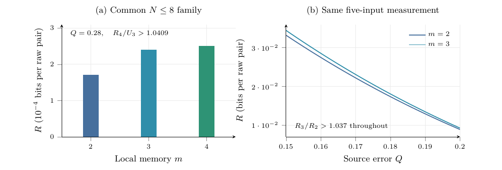

# Quantum memory as an efficiency resource for key distillation

Code, data and LaTeX figures for the ED+AD memory study. The manuscript
counts net secret bits per consumed raw Bell pair, including rejected
attempts and repeated preparation.

本仓库包含论文核心结果的代码、数据和图片源码。建议先运行下面的快速检查，
再阅读 `qkd_core.py` 中的公式实现；完整数值计算的入口和范围见后面的对应表。

## Start here

Use Python 3.11 or newer. The small reference checks need only NumPy:

```bash
python -m pip install numpy
python quick_check.py
```

The check enumerates all 120 orders of the five-input measurement, finds
8 orders feasible with two qubits and 120 with three, and reproduces
`C2 = 2975/173`, `C3 = 11425/692`, and `R3/R2 = 476/457`.
It also checks the basic B-round and linear-code coefficients.

`qkd_core.py` is the readable starting point:

| Function | Meaning |
|---|---|
| `graph_schedule` | Exact memory, continuation probabilities, acceptance and raw-pair cost for a fixed Werner measurement |
| `z_ed_step` | Accepted Bell law and success probability of a two-input ZZ ED operation |
| `combine_memory`, `combine_cost` | Retaining one prepared pair while producing the second |
| `b_round`, `classical_rate` | Classical selection yields and subsequent extraction |
| `linear_code_rates` | Conditional-entropy sums for clear tags and charged OTP modes |
| `watanabe_rate` | The two-way reconciliation and privacy-amplification coefficient |

Bell probabilities use `(I,X,Y,Z)` order. The reference linear-code
implementation uses a column generator of shape `(n,k)`, matching the
manuscript; the optimized engines may store its transpose. All binary
matrix operations are modulo two. The reference calculations use ordinary
floating arithmetic for entropies and exact fractions for Werner costs.
The interval engines below produce the reported numerical bounds.

## Paper figures and data

| Figure | LaTeX source in `figures/` | Principal data or construction |
|---|---|---|
| 1 | `protocol.tex` | ED-to-AD workflow and the three-input, two-memory circuit |
| 2 | `landscape.tex` | `data/global_rate_landscape.csv` |
| 3 | `matched.tex` | `data/figure3a_matched_control.csv`, `data/same_measurement_interval.csv` |
| 4 | `full_bb84.tex` | `data/revision_20261022_bb84_dense_curves.csv`, `data/revision_20261022_bb84_bounds.json` |
| S1 | `bb84_decoders.tex` | Explicit gates for the BB84 example protocols |
| S2 | `werner_schedules.tex` | Six-input Werner schedules at memories 2, 3 and 4 |
| S3 | `same_measurement_schedules.tex` | Two implementations of one five-input measurement |

Standalone vector images are in `figures/pdf/`; previews are in
`figures/png/`. Quantum circuits use **quantikz**, numerical plots use
**PGFPlots**, and the workflow uses TikZ. All plots use the supplied
coordinates directly.

To regenerate the LaTeX inputs and then compile the figures:

```bash
python scripts/prepare_publication_figures.py
python scripts/render_figures.py
# Optional PNG previews, with Poppler installed:
python scripts/render_figures.py --png
```

The second command needs a TeX installation with `quantikz`, `pgfplots`,
`standalone`, `adjustbox` and Latin Modern. The first command replays the
fixed circuit schedules and checks their dense Pauli matrices; it does
not run a new optimization.



## Recompute the numerical results

The complete engines are under `numerics/`. Their internal directory
layout preserves imports and catalogue paths. Its dated directory names
identify modules and data dependencies of this current calculation.
`numerics/requirements.txt` records the numerical environment.

```bash
python -m venv .venv
# Activate .venv using the command for your operating system.
python -m pip install -r numerics/requirements.txt
python numerics/REPRODUCE.py verify
```

The last command verifies the current package's hashes. To actually
recompute results, select the appropriate calculation:

| Task | Command from the repository root | Output |
|---|---|---|
| Arithmetic checks | `python numerics/REPRODUCE.py arithmetic` | Independent checks of the outward entropy and code-rate arithmetic |
| Werner landscape at one Q | `python numerics/REPRODUCE.py werner --q 0.2` | Feasible rates and complete-family upper bounds at the chosen source |
| BB84 fixed-policy search | `python numerics/REPRODUCE.py bb84-discover --q 0.2` | Feasible policies for the full two-input Clifford constructions |
| BB84 recursive-family upper | `python numerics/REPRODUCE.py bb84-upper --q 0.2` | Upper bounds using the policy output from the preceding step |
| BB84 dense curve coordinate | `python numerics/REPRODUCE.py bb84-curve --q 0.2` | Full-compatible-interval lower evaluation of the fixed portfolio |
| Protocol memory/frame checks | `python numerics/REPRODUCE.py portfolio` | Verification of the supplied concrete implementations |
| Common-source costs | `python numerics/REPRODUCE.py costs` | Exact cost/state decomposition of the Q=0.20 examples |

Run discovery before the recursive upper command for a fresh Q. The
complete-measurement component must also be included for the full union:

```bash
python numerics/research/revision_20261022/run_numerical.py block_component_upper.py --q .2 --ceiling .007393
```

Its ceiling is a computational pruning threshold. The full-family upper
is the maximum of this component and the recursive-family upper.

The independent matched Werner calculation is in `reproduction/`:

```bash
python reproduction/run.py controls-cert
python reproduction/run.py controls-circuits
python reproduction/run.py controls-check
python reproduction/run.py matched-interval
```

These commands respectively recompute the common N<=8 family, compile
its chosen schedules, verify the outputs, and enclose the comparison
over its stated source interval. Larger enumerations and interval
optimizations can take substantial time; their output directories and
logs are separate from the publication tables.

## Understanding the reported bounds

- The source family is a known Werner law or the BB84-compatible
  interval `z in [0,Q]`. A BB84 policy is fixed before this infimum.
- Mean consumption includes early rejection and the stated retry rules.
  Memory includes incoming qubits and retained intermediate pairs.
- The initial landscape includes the four elementary decoders; the
  expanded BB84 comparison includes all two-input Clifford maps within
  the stated finite construction limits.
- The dense BB84 curves are feasible fixed-policy envelopes. The
  separate lower/upper records establish the smaller-memory exclusions.
- Every classical coefficient includes its selection yield, IR and PA.
  OTP modes also subtract their secret-mask expense.

`data/revision_20261022_bb84_policies.json` specifies selected protocols,
final axes, B rounds and exact classical allocations.
`data/revision_20261022_dense_portfolio.json` records the curve portfolio.
`validation/publication_figures.json` identifies plotted source data and
the checks performed for the LaTeX circuit conversion.
